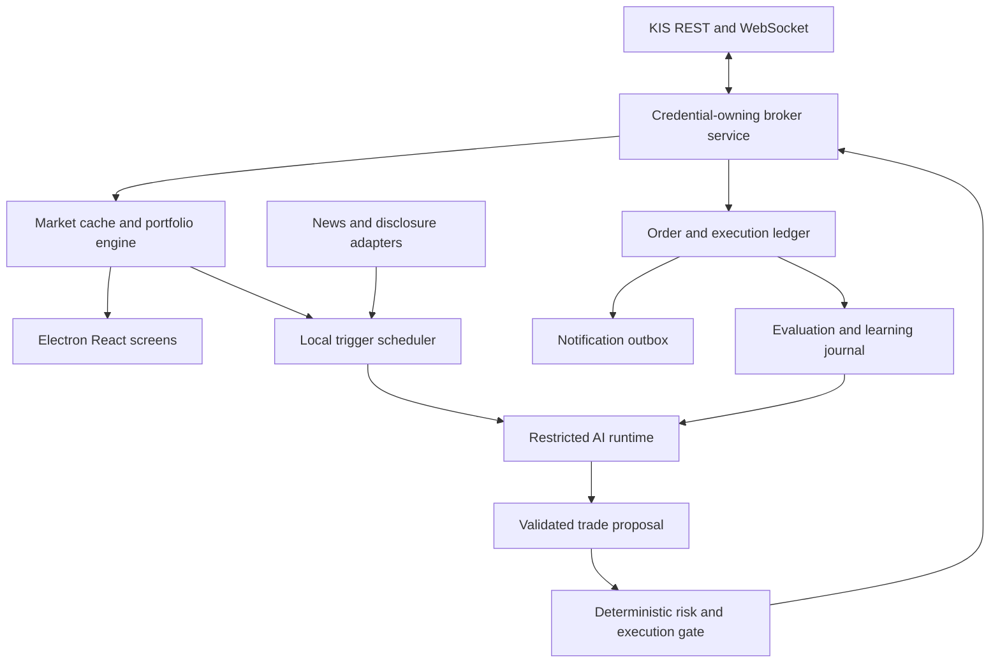

# Financial Portfolio Manager

Original design proposal — 2026-10-14. The domestic Windows workflow is implemented. README.md documents current behavior, activation controls, provider setup and service limitations. The sections below retain the original architecture rationale and roadmap.

## Product goal

A standalone Electron desktop application for understanding and managing a Korea Investment & Securities portfolio. It combines responsive market displays, allocation analysis, trading history, performance reporting, optional AI-assisted rebalancing, and an AI console view that makes program–agent interactions visible to the user.

Optimize risk-adjusted returns after fees, taxes, slippage, and turnover, subject to user-defined constraints. Profit maximization and loss minimization conflict; neither profitability nor prevention of losses can be guaranteed.

Initial scope assumption: Windows, one user, one KIS account, Korean cash equities, KRW reporting. Overseas equities and multi-account support follow after the domestic workflow is reliable. Proposed defaults are design choices, not user-approved trading limits.

## Frontend choice

| Consideration | Electron + React | Electron + jQuery |
|---|---|---|
| Initial setup | More tooling and concepts | Quick for a small screen |
| Live portfolio state | Components render from explicit state | Developers coordinate DOM changes and state manually |
| Tabs and detached windows | Reusable components with shared service subscriptions | Possible, but synchronization requires more custom structure |
| Long-term maintenance | Good fit for many interacting screens | Increasing coordination burden as the app grows |
| Charts | Integrates chart libraries through components | Integrates chart libraries directly |
| Performance | Requires batching and selective subscriptions | Requires batching and careful DOM updates |
| Electron footprint | Chromium/Node overhead remains | Chromium/Node overhead remains |

Recommendation: Electron + React + TypeScript. React is a better architectural fit for this project's stateful dashboard; it is not an automatic guarantee of better performance. Use a chart adapter so the candle and allocation libraries can be selected after checking licensing, Electron compatibility, and benchmark results.

## System boundaries

- Electron renderer: displays sanitized data; no credentials, filesystem APIs, or direct broker calls.
- Preload: narrowly scoped, typed IPC methods; validate message schemas and sender identity.
- Electron main: window lifecycle and routing; avoid heavy calculations on its event loop.
- Broker service: imports credentials, owns KIS sessions, submits orders, and reconciles account state. It exposes named operations, never arbitrary URLs, scripts, or file reads.
- Portfolio service: holdings, cash, allocation, valuation, analytics, and source freshness.
- AI adapter: provider-independent interface for structured decisions and budget accounting.
- Interaction event service: publishes sanitized, ordered program–agent events to the AI console and persists completed exchanges for later inspection. Redaction happens before persistence or renderer delivery.
- Storage: local SQLite for snapshots, orders, fills, decisions, source references, evaluations, and notification delivery attempts. Secrets are excluded.
- Optional agent interface: MCP or a typed local RPC protocol, sharing the same validation and execution policy as the desktop UI.

Electron must use context isolation, renderer sandboxing, disabled renderer Node integration, a restrictive content security policy, and validated IPC. A local agent endpoint should prefer authenticated named pipes; any loopback HTTP alternative needs authentication and request-origin protections.

## Credentials: enforce the user's requirement

The user imports a JSON credential file through a native file picker. The broker alone parses it. Store runtime secrets using OS-protected storage and restrict the original file's permissions; importing it does not erase the original plaintext file. Never copy it into the repository, renderer state, logs, AI prompts, crash telemetry, or database.

An AI process running with the same unrestricted Windows identity could still read the file. A separate process alone is not isolation. Run the agent with an enforced sandbox or a separate restricted identity that denies access to the source JSON, broker secret storage, process memory, and arbitrary filesystem/shell tools. A cloud inference adapter should receive only allowlisted snapshots and named tool results.

Credentials remain private, but selected holdings, prices, and journal excerpts may be sent to the chosen AI provider. Make that data sharing visible in settings. Redact account identifiers and all authentication material from tool outputs and exceptions.

Acceptance criterion: an agent attempting file reads or requesting credentials cannot obtain either the imported JSON or any broker/OpenAI authentication secret. Development agents must use fixtures, never real credential files.

## Market data and refresh timing

KIS provides REST and WebSocket interfaces. Use WebSocket for supported live events and REST for account reconciliation, historical candles, and recovery. Verify endpoint-specific permissions, subscription limits, rate limits, and mock/live differences before implementation; do not assume 30 REST calls per second are allowed.

Three independent clocks:

1. Ingestion: consume broker events as they arrive, with bounded buffers and reconnect recovery.
2. Display: configurable 1 Hz or up to 30 Hz coalesced rendering of the latest state. Thirty screen updates per second do not create thirty fresh broker quotes per second.
3. Decisions: periodic/event-triggered analysis, usually minutes apart, subject to cooldown and budget.

Cache quotes; batch UI messages; subscribe only to relevant instruments. Detect stale data, sequence gaps, duplicate events, and disconnections. After reconnect or resume from sleep, refresh holdings, cash, and open orders before permitting new trades. Exchange calendars and trading-session status must be data-driven.

## Screens

- Overview: equity, cash, buying power, realized/unrealized P&L, selected-period returns, connection freshness, automation mode, and allocation pies by company, sector, and region.
- Holdings: quantity, cost basis, market value, exposure, target weight, and drift. Include cash and an explicit unknown classification. Region initially means listing region; revenue exposure and ETF look-through require additional metadata.
- Charts: candles, volume, price history, timeframe selection, and trade markers; available as a tab or detached window. Distinguish adjusted historical series from execution prices.
- Activity: separate orders and fills, including partial fills, cancellations, rejections, fees, execution timestamps, manual/AI origin, and decision references.
- Performance: daily/monthly/custom-period P&L and return graphs; distinguish cash deposits from earnings, realized from unrealized gains, and gross from net results. Support time-weighted returns and eventually money-weighted returns. Mark unavailable historical periods rather than inventing them.
- AI journal: triggers, evidence, proposals, risk rejections, evaluations, model/strategy versions, and measured usage.
- AI console: a view in the current application window showing the live program–agent conversation, supplied context, tool activity, and execution status; selecting the sidebar entry switches views.
- Settings: credential import status, mock/live environment, risk policy, budget, alerts, and automation controls. No secret display.

Appearance: provide a light/dark switch in the header, persist the selection, and apply it throughout the application. Open the AI console from the sidebar; omit a redundant console/chat button from the main header.

Use decimal arithmetic or integer minor units for money, explicit currencies, and recorded FX timestamps for later overseas support. Internal timestamps use UTC; display Asia/Seoul for the initial product.

## AI console view

The sidebar switches the current window to the console view. Changing views does not interrupt the agent or trading service. The console subscribes to the sanitized interaction event service and restores recent persisted exchanges when revisited. This follows the updated user preference from 2026-10-15.

Show a timestamped timeline grouped by agent run, with clear labels for program requests, agent responses, tool requests/results, and system events. Stream response text when the provider supports it. Display the trigger, run status (queued, running, completed, failed, or canceled), model/provider, latency, token usage, and estimated cost when available; label unavailable measurements explicitly.

Provide an expandable context inspector showing the actual allowlisted context supplied for that run: instructions, portfolio snapshot/version, market summaries, source references, retrieved journal entries, and conversation summaries. Indicate omissions, truncation, and redacted fields. Show agent-provided explanations and decision summaries; do not imply access to private internal reasoning or context the provider does not expose.

Link proposals, risk-gate approvals/rejections, order submissions, and fills to their originating run so users can follow an interaction through its trading outcome. Include connection failures, retries, timeouts, budget exhaustion, and recovery messages. This is an observation surface; execution permissions remain governed by the existing trading mode and risk gate.

Support search, run/status filters, pause/resume auto-scroll, copy, and user-initiated export of sanitized transcripts. Pausing the display or navigating away does not pause trading. Render messages as untrusted text, with no executable HTML. Use bounded live buffers and a virtualized timeline so long sessions do not slow the portfolio screens. Make local transcript retention configurable; exports may contain private portfolio information even after secret redaction.

Completion checks: replay a synthetic run from trigger through response, tool calls, proposal, risk result, and fill; verify event order and run links; revisit the console and recover its transcript; confirm display pause/view navigation leaves execution unaffected; and verify credential fixtures never appear in displayed, stored, copied, or exported events.

## AI engine and affordability

Recommendation: the program monitors markets locally and invokes an AI adapter only when needed. ChatGPT dots can be explored as an optional interactive research/control client; desktop monitoring and execution should not depend on a conversational agent remaining awake.

Current OpenAI documentation describes eligible Plus/Pro plan usage through Sign in with ChatGPT for participating apps and an open-source client flow. Treat this as an integration candidate, not guaranteed unlimited access: validate client eligibility, preview restrictions, supported models/tools, session renewal, and suitability for unattended trading. Do not assume Plus automatically covers ordinary API-key usage or dots and API workloads interchangeably.

Provider options:

| Option | Benefit | Constraint |
|---|---|---|
| Eligible ChatGPT plan integration | May meet the Plus subscription preference | Eligibility, shared plan limits, and integration restrictions require validation |
| API-key provider | Explicit usage accounting and integration control | Separate provider billing must be budgeted |
| Local model | No per-request cloud token charge | Hardware, latency, and decision quality require evaluation |
| Dots as optional client | Conversational research and portfolio review | Validate supported communication and scheduling; not an execution dependency |

Triggers include a configurable ten-minute review, target-weight drift, abnormal price/volume movement, a material disclosure, and a user request. Apply hysteresis, cooldowns, event deduplication, and one decision run at a time. Coalesce repeated events into one snapshot. Sudden moves can invoke deterministic controls immediately without waiting for an LLM.

A hypothetical 6.5-hour session reviewed every ten minutes produces about 39 scheduled runs, before additional events. At 22 sessions this is about 858 runs monthly; actual counts depend on exchange sessions and chosen schedule. Cost estimation is input tokens × input rate + output tokens × output rate + tool charges. Measure real usage before selecting a model or claiming affordability.

Send compact summaries and relevant journal excerpts. Cap input/output tokens, calls per day, retries, and API spend. On budget exhaustion, preserve monitoring and show the fallback mode; do not silently switch to a paid provider.

## Agent communication and execution

Expose capabilities such as `getPortfolioSnapshot`, `getMarketSummary`, `getTradeHistory`, `getRelevantEvents`, `proposeRebalance`, and `getProposalStatus`. Scriptability means stable schemas and explicit capabilities, not general shell access. Restrict pause/resume and policy changes by caller role; the AI cannot expand its own authority.

A proposal carries an ID, snapshot version, creation/expiry timestamps, environment, evidence references, rationale, and legs with instrument, side, quantity, order type, and limit price when applicable. The gate resolves the permitted account internally.

Risk checks cover instrument allowlists, maximum order size, cash and available holdings, pending-order reservations, concentration, turnover, daily loss budget, spread/slippage, price freshness, market status, and proposal expiry. Recheck immediately before each submission. Prohibit margin and short selling initially. A loss limit stops new trading; it cannot guarantee a maximum realized loss during gaps or illiquidity.

Provide three explicit modes: observation, approval-required trading, and bounded automatic trading. Start with observation and mock execution. Users must deliberately enable live automation and define its risk limits.

Persist an order intent before network submission. A timeout may mean the broker accepted an order: reconcile its status before retrying. Local IDs alone do not provide broker-side idempotency. Handle partial fills, rejections, cancellation races, and unfilled orders. Multi-leg rebalancing is not atomic; each subsequent leg must use actual fills and current buying power.

A visible kill switch stops new submissions. Open-order cancellation is a distinct action whose success must be confirmed. Restart recovery queries broker state before resuming. If broker state is uncertain, block new orders and surface the uncertainty.

## Learning, news, and events

Store each decision's contemporaneous inputs, cited evidence, assumptions, expected outcome/horizon, strategy/model versions, fills, and later results after costs. Separate execution errors, bad source data, and investment hypotheses that did not work. A loss alone does not establish that the decision was irrational.

Generate candidate lessons and retrieve relevant ones for future analyses. This is persistent memory and evaluation, not automatic model-weight training. Evaluate changes on held-out chronological data and forward paper trading, accounting for fees, slippage, corporate actions, survivorship bias, and look-ahead bias. Promote versioned changes only after review; the agent must not rewrite risk controls or production code.

Use source adapters for corporate disclosures, licensed news, consensus estimates, and macroeconomic/geopolitical events. Verify provider coverage, licensing, costs, and latency before selection. Record both publication and ingestion timestamps, affected companies, URLs, and corrections. Deduplicate stories and label stale sources. Treat article text as untrusted evidence: embedded instructions cannot invoke tools or alter policy.

## Notifications and availability

Provide desktop alerts and an optional mobile push/webhook adapter. Record alerts in a durable outbox and retry with deduplication. Distinguish submitted, partially filled, filled, rejected, and canceled orders. Include instrument, quantity, execution price, brief rationale, and current mode; omit secrets and full account numbers. Mobile delivery requires an external service or a companion backend and explicit user configuration.

A desktop process cannot monitor while the computer is powered off or asleep. Tray operation helps only while the process and computer remain running. If unattended availability while the PC is offline is required, add a separately deployed service with its own credential/security design.

## Delivery roadmap and completion checks

1. Foundation: Electron/React/TypeScript, secure IPC, synthetic KIS adapter, SQLite, overview/holdings/chart/activity screens, and an AI console view with synthetic interaction events. Check valuation, allocation, timestamp, and cash-flow accounting with fixtures.
2. Read-only KIS: user-controlled credential import, account reconciliation, quote stream, reconnect recovery. Confirm secrets never cross renderer/AI boundaries and stale status is visible.
3. Mock trading: persistent intent/fill ledger and deterministic risk gate. Test duplicate triggers, ambiguous timeouts, partial fills, cancel races, restart, and disconnect behavior. KIS mock availability and differences must be confirmed per endpoint.
4. AI advisory: compact event snapshots, provider adapter, structured proposals, journal, token budgets, approval flow, and live console conversation/context/tool streaming. Check malformed proposals, prompt injection, denied secret access, transcript redaction, and console lifecycle behavior.
5. Limited live automation: deliberate opt-in, configured limits, independently verified reconciliation, kill switch, and mobile alerts. Observe controlled execution before expanding instruments or capital.
6. Evaluation: source adapters, strategy comparisons, reviewed memory, and optional overseas/multi-account/service deployment.

Outstanding product decisions: domestic-only versus overseas launch scope; personal use versus distribution; whether the desktop stays online; permitted capital/instruments/loss budget; mobile channel; and eligibility of the preferred ChatGPT plan integration. Broker/provider terms and distribution requirements need verification before release.

## Verified reference entry points

- [KIS Developers](https://apiportal.koreainvestment.com/intro): REST and WebSocket overview.
- [Official KIS samples](https://github.com/koreainvestment/open-trading-api): implementation reference; endpoint limits and permissions still require specific checks.
- [Electron security](https://www.electronjs.org/docs/latest/tutorial/security): process and renderer security recommendations.
- [Thinking in React](https://react.dev/learn/thinking-in-react): component, state, and data-flow model. The framework comparison above is engineering judgment.
- [Sign in with ChatGPT quickstart](https://developers.openai.com/siwc/quickstart): eligible plan usage and open-source integration route.
- [Preview limitations](https://developers.openai.com/siwc/token-sharing-open-source/preview-limitations): integration restrictions to verify in the AI feasibility phase.
- [Meet dots](https://learn.chatgpt.com/docs/dots): optional conversational agent context; no trading execution reliability or cost guarantee is inferred.
